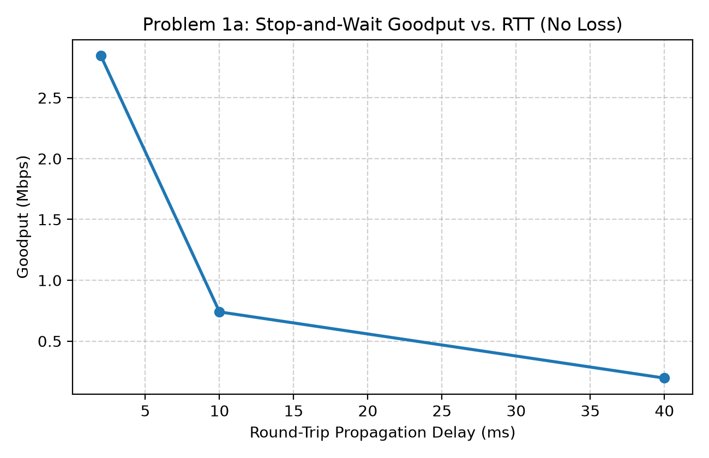
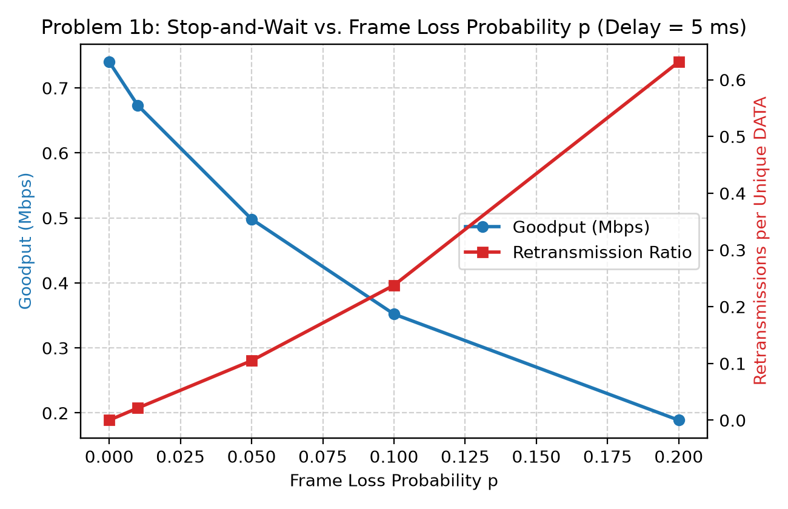
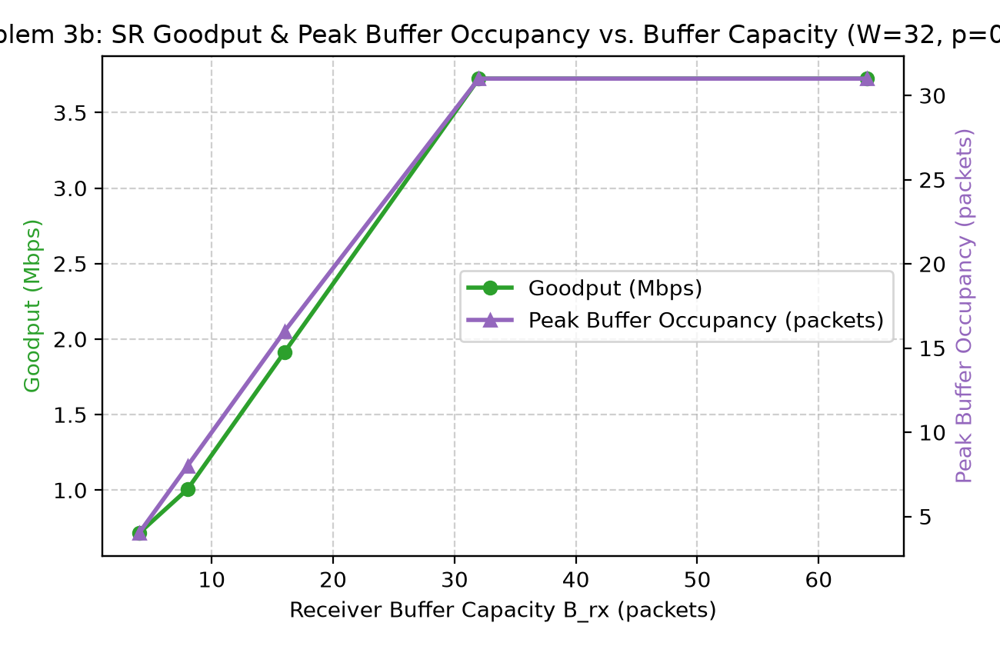

# ns-3 Homework 3 Report: Flow Control and Reliable Transmission

## 1. Setup and Reproducibility
- **Topology & Link:** 2 nodes over `PointToPoint` (`10 Mbps`, `5 ms` baseline one-way propagation delay, `1000-byte` payload, `30 s` simulation, `20-packet` default receiver buffer).
- **Seed & Timeouts:** Fixed seed `42`; RTO = `30/50/100 ms` (P1a), `50 ms` (P1b), `60/120 ms` (P2a), `60 ms` (P3a/P3b). Independent uniform loss `p` applied identically to `DATA` and `ACK` frames when enabled.

## 2. Problem 1: Stop-and-Wait
- **1a & 1c ($p=0$, $T_f = 0.8\text{ ms}$):**
  - `1 ms` delay (`RTT = 2 ms`): Goodput `2.8456 Mbps` (approx `2.8571 Mbps`, $U \approx 0.2857$), Mean Delay `2.8112 ms`, Timeouts `0`.
  - `5 ms` delay (`RTT = 10 ms`): Goodput `0.7400 Mbps` (approx `0.7407 Mbps`, $U \approx 0.0741$), Mean Delay `10.8073 ms`, Timeouts `0`.
  - `20 ms` delay (`RTT = 40 ms`): Goodput `0.1960 Mbps` (approx `0.1961 Mbps`, $U \approx 0.0196$), Mean Delay `40.8112 ms`, Timeouts `0`.
  - Higher propagation delay drops utilization; overly short RTO triggers premature retransmissions, whereas overly long RTO stalls recovery after loss.
- **1b (`delay = 5 ms`):** For $p \in \{0, 0.01, 0.05, 0.10, 0.20\}$, Goodput drops (`0.7400`, `0.6733`, `0.4981`, `0.3520`, `0.1888 Mbps`), while retransmission ratio (`0`, `0.0214`, `0.1049`, `0.2379`, `0.6314`) and timeouts (`0`, `54`, `196`, `314`, `447`) rise.
-  | 

## 3. Problem 2: Go-Back-N and BDP
- **2a ($p=0$):** For $W \in \{1,2,4,8,16,32\}$, Goodput rises from `0.7400` to `8.3149 Mbps` (`5 ms` delay) and from `0.1960` to `5.5893 Mbps` (`20 ms` delay).
- **2b & 2c:** $\text{BDP} = 100\text{ kbits}$ ($W \approx 13$) at `5 ms` and $400\text{ kbits}$ ($W \approx 50$) at `20 ms`. Increasing $W$ fills the pipe until link capacity saturates (`10 Mbps` minus header/frame overhead). Flow control protects the receiver buffer; congestion control protects intermediate network links/queues.
- 

## 4. Problem 3: Selective Repeat and Receiver Buffering
- **3a ($p=0.05$, `B_rx = 20`):** SR achieves `2.2973 Mbps` (`W=16`) and `2.4357 Mbps` (`W=32`) vs GBN `1.6299 Mbps` and `1.4912 Mbps` by retransmitting only lost packets rather than the entire window.
- **3b & 3c (`W=32`, $p=0.05$):** For $B_{\text{rx}} \in \{4,8,16,32,64\}$, Goodput is `0.7139`, `1.0051`, `1.9144`, `3.7248`, `3.7248 Mbps` with Peak Buffer Occupancy `4, 8, 16, 31, 31` (never exceeding $B_{\text{rx}}$). When buffer is full, out-of-order frames are dropped without ACK until retransmitted; once $B_{\text{rx}} \ge W$, overflow ceases.
-  | 
