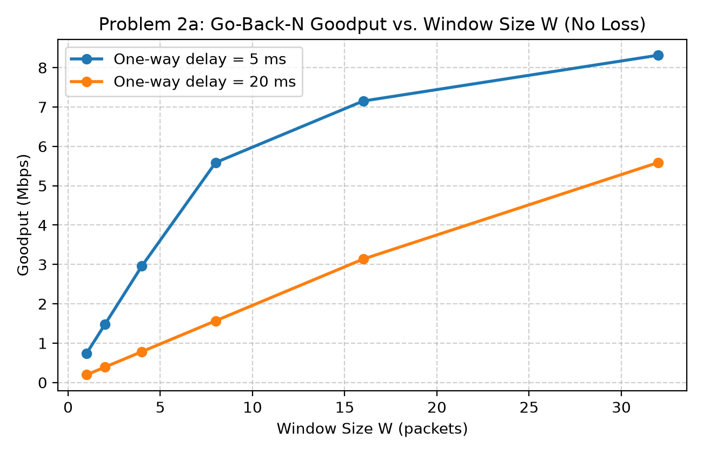
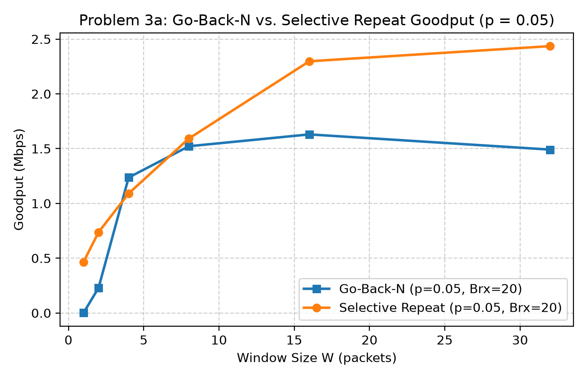

# ns-3 Homework 3 Report: Flow Control and Reliable Transmission

## 1. Setup and Reproducibility
- **Topology & Link:** 2 nodes connected by a `PointToPoint` link (`10 Mbps` data rate, `5 ms` baseline one-way propagation delay, `1000`-byte payload, `30 s` simulation duration, `20`-packet baseline receiver buffer, continuous offered traffic).
- **Seed & Timeouts:** Fixed seed `42`; ACK timeout (`--rtoMs`) set to `30/50/100 ms` in P1a, `50 ms` in P1b, `60/120 ms` in P2a, and `60 ms` in P3a/P3b. Independent uniform frame-loss probability `p` is applied identically to `DATA` and `ACK` frames when enabled.

## 2. Problem 1: Stop-and-Wait
- **1a & 1c ($p = 0$, $T_f = L/R = 0.8\text{ ms}$, $U \approx T_f / (T_f + \text{RTT}_{\text{prop}})$):**
  - `1 ms` one-way delay (`RTT = 2 ms`): Goodput = `2.8456 Mbps` (approx. `2.8571 Mbps`, $U \approx 0.2857$), Mean Delay = `2.8112 ms`, Timeouts = `0`.
  - `5 ms` one-way delay (`RTT = 10 ms`): Goodput = `0.7400 Mbps` (approx. `0.7407 Mbps`, $U \approx 0.0741$), Mean Delay = `10.8073 ms`, Timeouts = `0`.
  - `20 ms` one-way delay (`RTT = 40 ms`): Goodput = `0.1960 Mbps` (approx. `0.1961 Mbps`, $U \approx 0.0196$), Mean Delay = `40.8112 ms`, Timeouts = `0`.
  - Larger propagation delay lowers utilization because Stop-and-Wait sends only one frame per RTT. A too-short RTO causes premature timeouts and wasted retransmissions, while a too-long RTO slows down recovery after packet loss.
- **1b (`delay = 5 ms`, `RTO = 50 ms`):** For $p \in \{0, 0.01, 0.05, 0.10, 0.20\}$, Goodput decreases (`0.7400`, `0.6733`, `0.4981`, `0.3520`, `0.1888 Mbps`), while retransmission ratio (`0.0000`, `0.0214`, `0.1049`, `0.2379`, `0.6314`), timeout count (`0`, `54`, `196`, `314`, `447`), and mean delivery delay (`10.8073` to `42.2931 ms`) increase.
- 
- 

## 3. Problem 2: Go-Back-N and BDP
- **2a ($p = 0$):**
  - `5 ms` delay: For $W \in \{1, 2, 4, 8, 16, 32\}$, Goodput rises from `0.7400 Mbps` to `8.3149 Mbps` and Mean Delay goes from `10.8073 ms` to `30.7726 ms`.
  - `20 ms` delay: For $W \in \{1, 2, 4, 8, 16, 32\}$, Goodput rises from `0.1960 Mbps` to `5.5893 Mbps` and Mean Delay goes from `40.8112 ms` to `45.7709 ms`.
- **2b & 2c:** At $R = 10\text{ Mbps}$ and $L_{\text{bytes}} = 1000$, $\text{BDP} = 100\text{ kbits}$ ($W \approx 13$ packets) for `5 ms` delay and $\text{BDP} = 400\text{ kbits}$ ($W \approx 50$ packets) for `20 ms` delay. Increasing $W$ initially raises goodput linearly until the link/pipe fills; afterward, goodput levels off due to link capacity (`10 Mbps`), finite frame transmission time ($T_f = 0.8\text{ ms}$), and framing overhead, while delay increases. **Flow control** prevents receiver buffer overflow, whereas **congestion control** prevents network link and router queue overload.
- 

## 4. Problem 3: Selective Repeat and Receiver Buffering
- **3a ($p = 0.05$, `delay = 5 ms`, `B_rx = 20`):** Selective Repeat outperforms Go-Back-N at larger windows (`W = 16`: `2.2973 Mbps` vs. `1.6299 Mbps`; `W = 32`: `2.4357 Mbps` vs. `1.4912 Mbps`) because it retransmits only lost frames rather than rolling back the entire window.
- **3b & 3c (`W = 32`, `p = 0.05`):** For $B_{\text{rx}} \in \{4, 8, 16, 32, 64\}$, Goodput is `0.7139`, `1.0051`, `1.9144`, `3.7248`, and `3.7248 Mbps`, with Peak Buffer Occupancy `4`, `8`, `16`, `31`, and `31` packets (never exceeding $B_{\text{rx}}$). When the receiver buffer is full, out-of-order frames are dropped without sending an ACK so the sender retransmits on timeout; once $B_{\text{rx}} \ge W$, receiver buffer overflow no longer restricts throughput.
- 
- 
